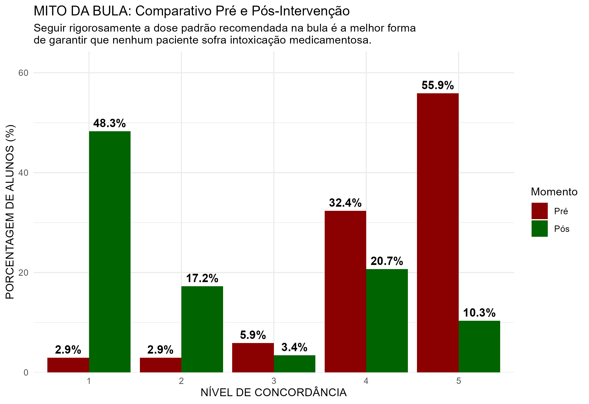
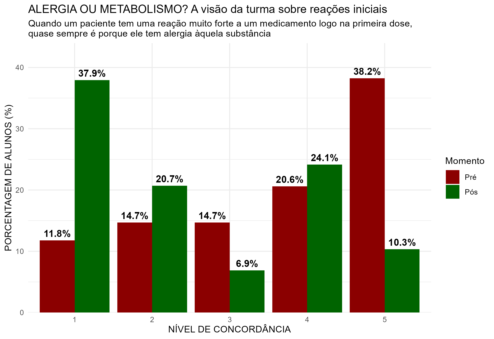
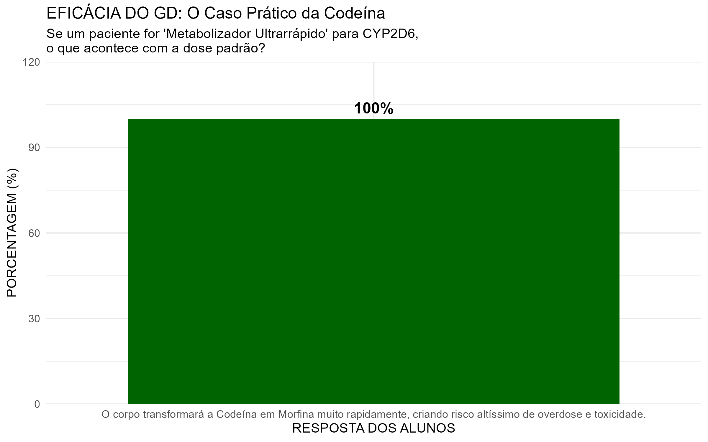
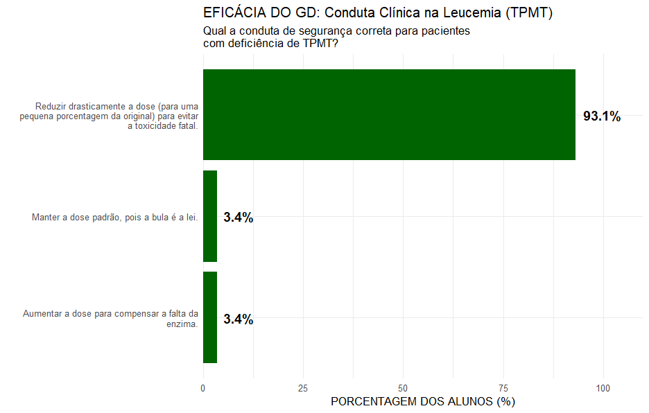
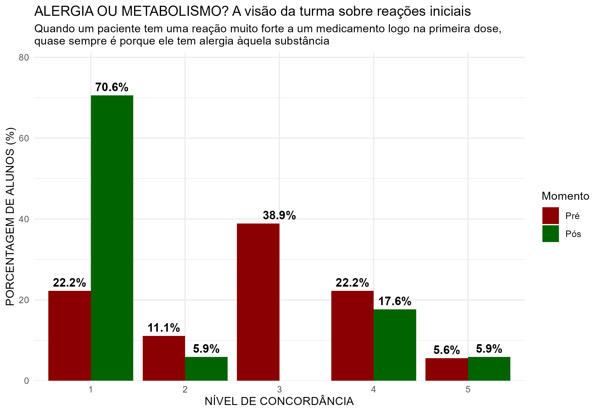
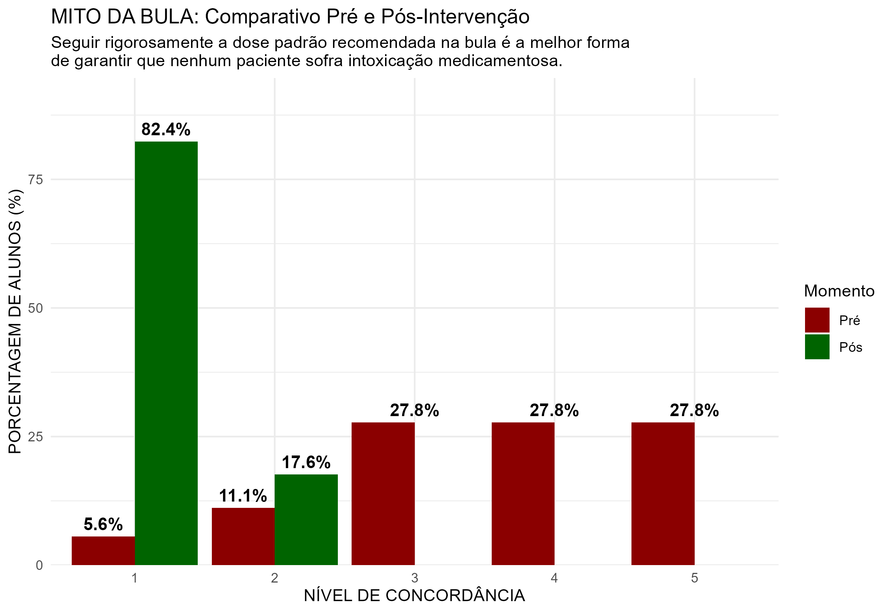
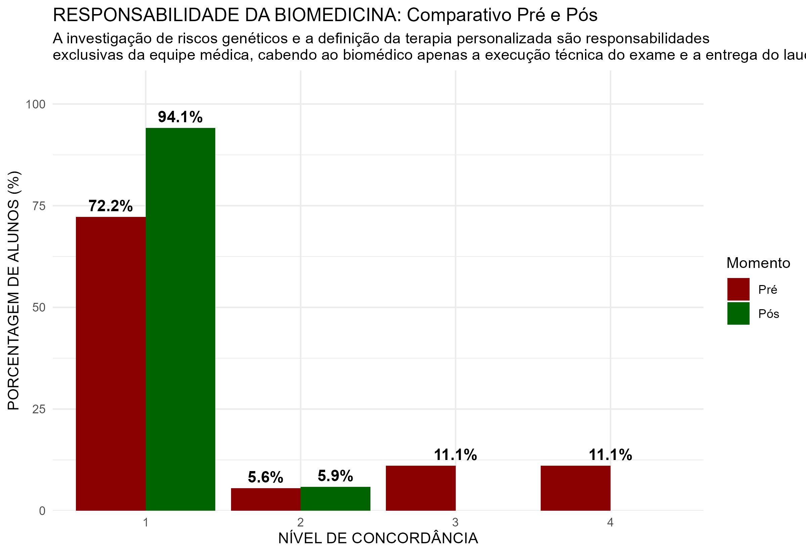

# Pharmacogenetics Health Education Analysis

> **Data-driven analysis of pharmacogenetics education impact. | Projeto de análise de dados e impacto educacional em farmacogenética para estudantes da área da saúde (UFMG).**

🇺🇸 *[Read this in English](README_EN.md)*

---

## ⌛ Status do Projeto & Ciclos Analíticos

### Ciclo 2026/2 (Em Andamento)
> **Enfermagem 2026/2 ⏳**
> *Coleta pré-intervenção, Grupo de Discussão (GD) e coleta pós-intervenção concluídas. Dados em fase de tratamento e análise (ETL pendente).*
>
> **Farmácia 2026/2 ⏳**
> *Coleta de linha de base (pré-intervenção) finalizada. Aguardando intervenção completa (Aula + GD) e coleta pós-intervenção para gerar a análise comparativa final.*

### Ciclo 2026/1 (Concluído)
> **Enfermagem 2026/1 ✅**
> *Aplicação do questionário pré-intervenção, Grupo de Discussão (GD), coleta pós-intervenção e análise comparativa finalizadas com sucesso.*
>
> **Biomedicina 2026/1 ✅**
> *Coleta pré e pós-intervenção concluídas. Intervenção realizada apenas com Aula Teórica Expositiva (sem GD), atuando como grupo controle metodológico para as demais turmas.*

---

Este projeto tem o objetivo de avaliar o conhecimento de estudantes da área da saúde sobre farmacogenética e medir o impacto de intervenções educativas baseadas em dados clínicos, utilizando uma abordagem estruturada de análise de dados e estatística descritiva.

## 📌 Objetivo
Identificar e analisar, por meio de dados, lacunas na formação acadêmica sobre genética e farmacogenética, avaliando quantitativamente se uma intervenção educacional melhora o entendimento dos estudantes sobre a segurança do paciente e a tomada de decisão clínica.

## ⚠️ O Problema (Baseado na Literatura Científica)
Estudos recentes apontam que a defasagem no ensino de medicina de precisão não é um problema isolado, mas uma falha sistêmica na formação de toda a equipe multidisciplinar de saúde. Profissionais apresentam baixa confiança na interpretação de testes genéticos e na aplicação da farmacogenética na prática. A formação acadêmica tradicional ainda oferece pouca preparação para lidar com essas informações, o que impacta diretamente a prevenção de reações adversas e a segurança do paciente.

> *Fonte: Análise bibliográfica estruturada de 17 artigos científicos ([ver pasta /docs](./docs)).*

## 🏆 Principais Resultados (Data Insights - Enfermagem 2026/1)
A extração e análise dos dados após a intervenção educacional completa (Aula + GD) revelaram uma quebra clara de mitos do senso comum e alta retenção de condutas clínicas de segurança:

* **Quebra do Mito da Bula:** A concordância total de que "seguir rigorosamente a bula evita intoxicação" caiu drasticamente, dando lugar a uma discordância de **48.3%** no pós-intervenção.

* **Mudança de Paradigma (Alergia vs. Metabolismo):** A visão inicial de que reações severas na primeira dose são sempre "alergias" foi revertida, com a maioria da turma passando a discordar dessa premissa após a intervenção educacional.

* **Retenção Clínica Prática:** **100%** dos alunos identificaram corretamente o risco letal de overdose no caso prático de metabolismo ultrarrápido da Codeína (CYP2D6), e **93.1%** acertaram a conduta de redução drástica de dose no caso da TPMT.

  
  

## 🏆 Principais Resultados (Data Insights - Biomedicina 2026/1)
Na turma de biomedicina, a intervenção foi realizada exclusivamente através de uma **Aula Teórica** sobre farmacogenética, sem a aplicação do Grupo de Discussão (GD) prático. Os dados demonstraram que a base expositiva isolada já possui um impacto estatístico significativo na correção de erros conceituais (Grupo Controle):

* **O Fim do "Muro da Prudência":** Na baseline, **38.9%** da turma de Biomedicina optou pelo nível "Neutro" quando questionada se intoxicações seriam sempre alergias. Após a aula teórica, a indecisão despencou para **0%**, com a grande maioria (**70.6%**) assumindo a discordância total.
 

* **Pulverização do Mito da Bula:** A confiança no senso comum de que a "dose padrão salva a todos" foi erradicada. A turma saltou de respostas pulverizadas para um bloco sólido de **82.4%** de discordância total no pós-intervenção.
  
  
* **Empoderamento Profissional:** A discordância total de que os riscos genéticos são de responsabilidade "exclusiva da equipe médica" saltou de **72.2%** para **94.1%**, consolidando a compreensão do biomédico sobre a importância da sua responsabilidade técnica nos laudos.
   

## 🛠️ Tech Stack e Ferramentas
Este projeto utiliza programação estatística orientada a dados para extrair insights diretamente das bases de respostas:
* **Coleta de Dados:** Google Forms (Questionários estruturados em escala Likert).
* **Linguagem Principal:** `R`
* **Limpeza e Manipulação (ETL):** `dplyr` / `tidyr` (Pacote `tidyverse` para união de bases, renomeação de variáveis e fatoração).
* **Visualização de Dados:** `ggplot2` (Geração de gráficos comparativos com foco em *storytelling* em saúde e exportação automatizada).

## 📕 Metodologia do Pipeline de Intervenção
1. **Revisão Bibliográfica:** Análise de literatura para identificação de lacunas genéticas.
2. **Coleta de Baseline (Pré):** Questionário estruturado antes da intervenção.
3. **Intervenção Educativa:** Aula expositiva abordando fundamentos de farmacogenética.
4. **Aplicação Prática (GD):** Sessões de Grupos de Discussão voltadas a casos clínicos (aplicado em Enfermagem e programado para Farmácia; omitido em Biomedicina como grupo controle de método).
5. **Coleta de Validação (Pós):** Novo questionário para pareamento e medição de impacto.
6. **Análise Estatística em R:** Scripts para limpar (ETL), cruzar dados e modelar visualizações comparativas das turmas.

## 🧱 Estrutura do Repositório
* [**`/docs`**](./docs): Revisão bibliográfica, recortes de artigos e planejamento das intervenções.
* [**`/data`**](./data): Bases de dados anonimizadas em `.csv` separadas por curso.
* [**`/scripts`**](./scripts): Código completo em `R` contendo o pipeline unificado de ETL e geração de gráficos.
* [**`/plots`**](./plots): Gráficos exportados em alta resolução, organizados pelas fases da pesquisa.

## ▶️ Reprodutibilidade e Execução
Este projeto foi desenhado utilizando boas práticas de *pathing* relativo no RStudio. Para rodar o pipeline analítico localmente:

1. Realize o clone ou o download (ZIP) da estrutura completa do repositório para garantir que a hierarquia das subpastas fique preservada.
2. Abra o RStudio via `File > New Project > Existing Directory` na raiz da pasta descompactada.
3. Abra qualquer script contido na pasta `/scripts` (ex: `01_analise_enfermagem_2026_1.R`).
4. Execute o código (`Ctrl + A` e `Run`). O pipeline R irá acessar autonomamente os arquivos na pasta `/data`, realizar todo o tratamento estatístico e salvar os novos gráficos diretamente na pasta `/plots`.

> **Escalabilidade Analítica:** O código foi projetado de forma modular. Para analisar um novo semestre, basta adicionar a nova base `.csv` correspondente em `/data` e adaptar as variáveis de entrada no script, preservando toda a lógica do tratamento.

---
*Projeto de Extensão em Farmacogenética - Universidade Federal de Minas Gerais (UFMG)*

---

**Por Inácio Vieira** *Estudante de Enfermagem na Universidade Federal de Minas Gerais (UFMG) | Iniciando em Análise de Dados em Saúde* [LinkedIn](https://www.linkedin.com/in/inaciosantosvieira/)
**Professor Orientador:** Prof. Marcelo Rizzatti Luizon [Lattes](http://lattes.cnpq.br/1264026443614775)
