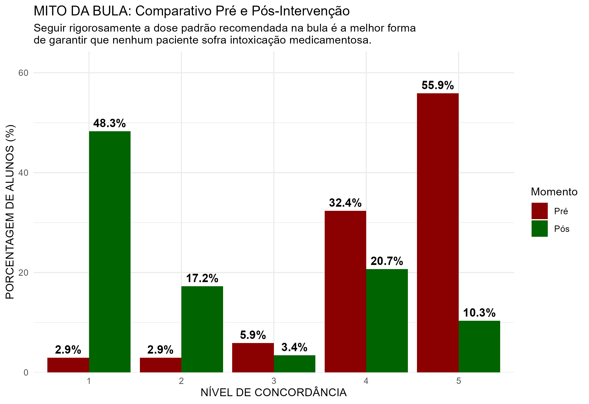
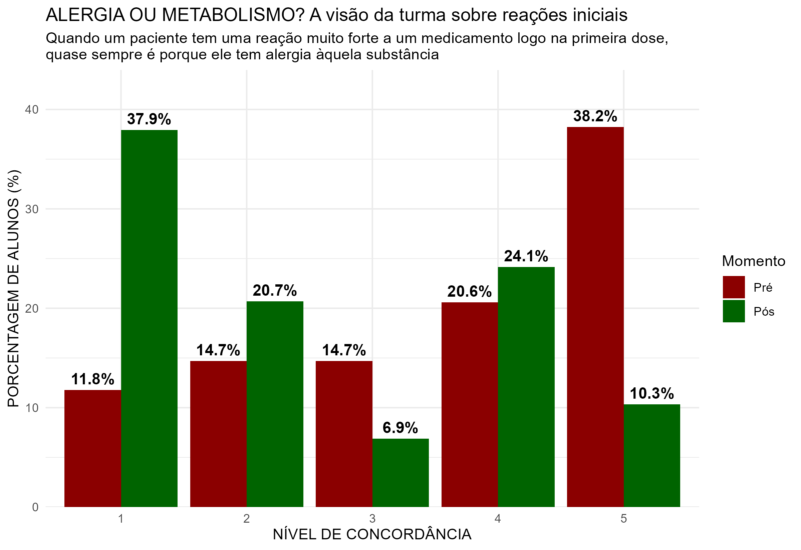
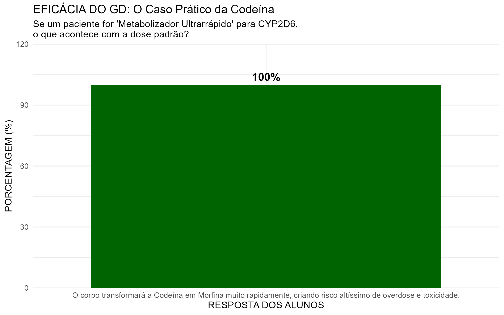
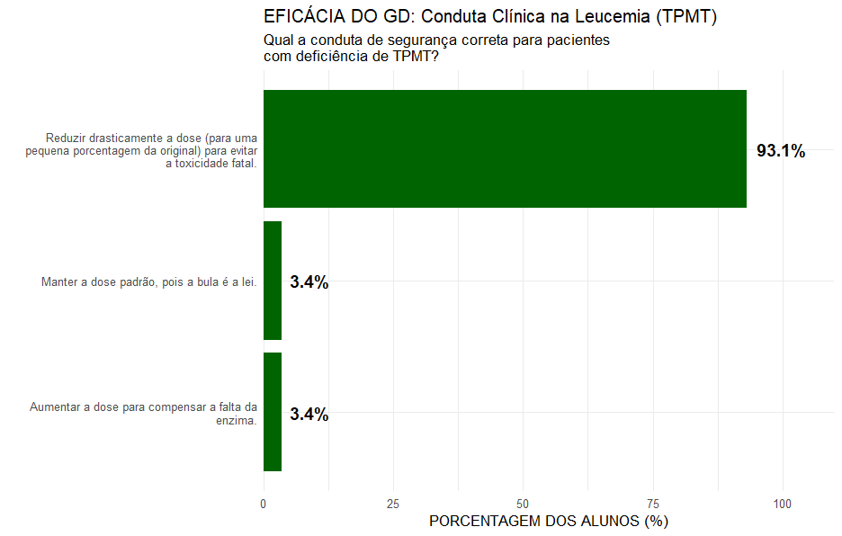
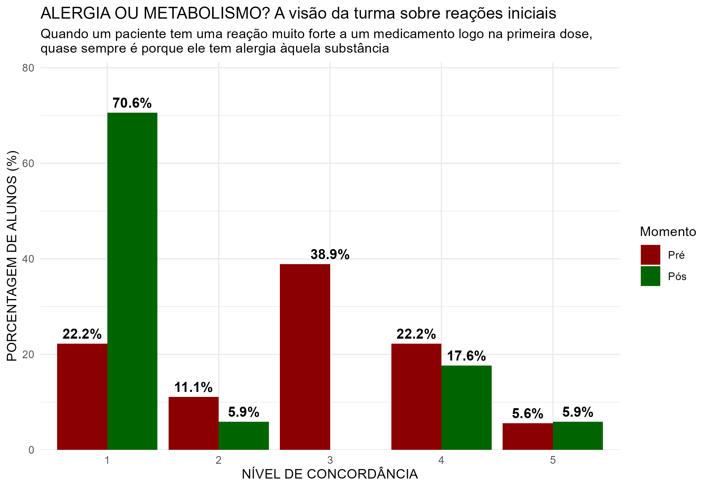
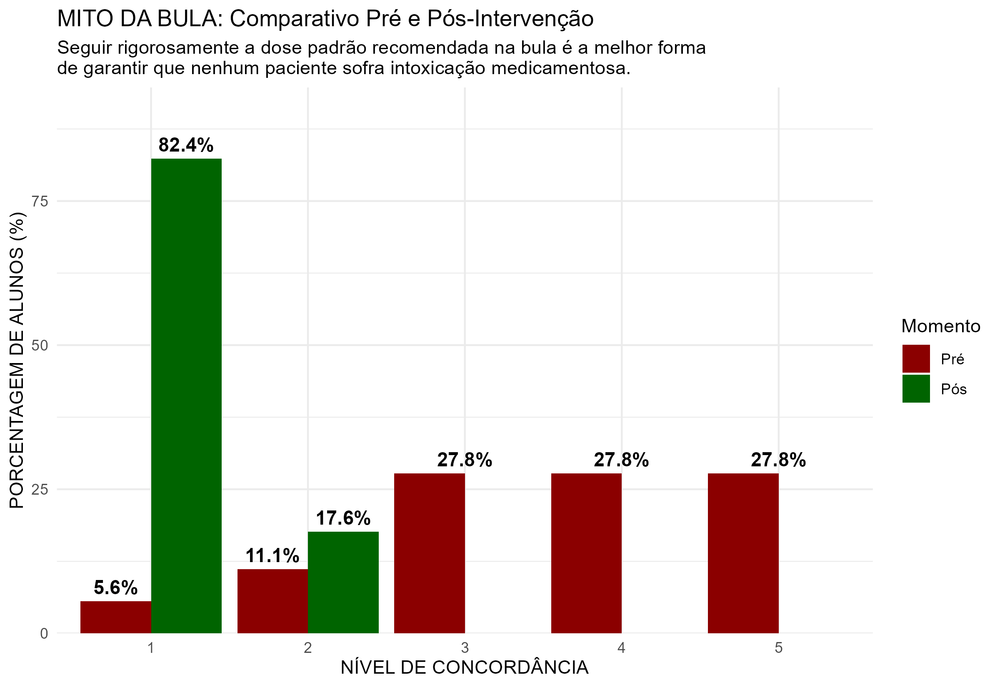
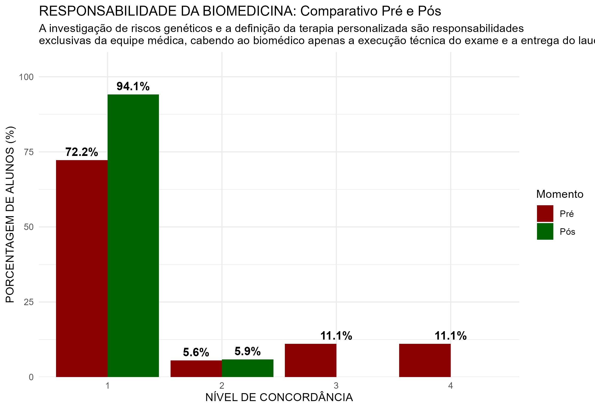

# Pharmacogenetics Health Education Analysis

> **Data-driven analysis of pharmacogenetics education impact for healthcare students (UFMG).**

🇧🇷 *[Leia em Português](README.md)*

---

## ⌛ Project Status & Analytical Cycles

### 2026/2 Cycle (In Progress)
> **Nursing 2026/2 ⏳**
> *Pre-intervention data collection, Discussion Group (GD), and post-intervention data collection completed. Data currently in the processing and analysis phase (ETL pending).*
>
> **Pharmacy 2026/2 ⏳**
> *Baseline data collection (pre-intervention) completed. Awaiting full intervention (Lecture + GD) and post-intervention data collection to generate the final comparative analysis.*

### 2026/1 Cycle (Completed)
> **Nursing 2026/1 ✅**
> *Pre-intervention questionnaire, Discussion Group (GD), post-intervention data collection, and comparative analysis successfully completed.*
>
> **Biomedicine 2026/1 ✅**
> *Pre and post-intervention data collection completed. Intervention conducted using only an Expository Theoretical Lecture (without GD), acting as a methodological control group for the other cohorts.*

---

This project aims to assess the knowledge of healthcare students regarding pharmacogenetics and measure the impact of educational interventions based on clinical data, using a structured data analysis and descriptive statistics approach.

## 📌 Objective
To identify and analyze, through data, gaps in academic training regarding genetics and pharmacogenetics, quantitatively assessing whether an educational intervention improves students' understanding of patient safety and clinical decision-making.

## ⚠️ The Problem (Based on Scientific Literature)
Recent studies indicate that the gap in precision medicine education is not an isolated issue, but a systemic failure in the training of the entire multidisciplinary healthcare team. Professionals show low confidence in interpreting genetic tests and applying pharmacogenetics in practice. Traditional academic training still offers little preparation to handle this information, directly impacting the prevention of adverse drug reactions and patient safety.

> *Source: Structured bibliographical analysis of 17 scientific articles ([see /docs folder](./docs)).*

## 🏆 Key Results (Data Insights - Nursing 2026/1)
Data extraction and analysis after the complete educational intervention (Lecture + GD) revealed a clear dismantling of common sense myths and high retention of safe clinical practices:

- **Shattering the Package Insert Myth:** Total agreement that "strictly following the package insert prevents intoxication" dropped drastically, giving way to a **48.3%** total disagreement post-intervention.

- **Paradigm Shift (Allergy vs. Metabolism):** The initial view that severe first-dose reactions are always "allergies" was reversed, with the majority of the class disagreeing with this premise after the educational intervention.

- **Practical Clinical Retention:** **100%** of the students correctly identified the lethal overdose risk in the practical case of Codeine ultra-rapid metabolism (CYP2D6), and **93.1%** correctly chose the drastic dose reduction approach for the TPMT case.

  
  

## 🏆 Key Results (Data Insights - Biomedicine 2026/1)
In the biomedicine cohort, the intervention was carried out exclusively through a **Theoretical Lecture** on pharmacogenetics, without the practical Discussion Group (GD). The data showed that the isolated expository foundation already has a significant statistical impact on correcting conceptual errors (Control Group):

- **The End of the "Wall of Caution":** In the baseline, **38.9%** of the Biomedicine cohort chose the "Neutral" option when asked if intoxications were always allergies. After the theoretical lecture, indecision plummeted to **0%**, with the vast majority (**70.6%**) assuming total disagreement.
 

- **Pulverization of the Package Insert Myth:** Confidence in the common sense belief that the "standard dose saves everyone" was eradicated. The cohort jumped from scattered responses to a solid block of **82.4%** total disagreement post-intervention.
  
  
- **Professional Empowerment:** Total disagreement that genetic risks are the "exclusive responsibility of the medical team" jumped from **72.2%** to **94.1%**, consolidating the biomedicine students' understanding of the importance of their technical responsibility in lab reports.
   

## 🛠️ Tech Stack and Tools
This project uses data-oriented statistical programming to extract insights directly from the response databases:
- **Data Collection:** Google Forms (Structured Likert scale questionnaires).
- **Main Language:** `R`
- **Data Cleaning and Manipulation (ETL):** `dplyr` / `tidyr` (`tidyverse` package for joining databases, renaming variables, and factoring).
- **Data Visualization:** `ggplot2` (Generation of comparative charts focusing on healthcare *storytelling* and automated export).

## 📕 Intervention Pipeline Methodology
1. **Literature Review:** Literature analysis to identify genetic knowledge gaps.
2. **Baseline Collection (Pre):** Structured questionnaire prior to the intervention.
3. **Educational Intervention:** Expository lecture covering pharmacogenetics fundamentals.
4. **Practical Application (GD):** Discussion Group sessions focused on clinical cases (applied in Nursing and scheduled for Pharmacy; omitted in Biomedicine as a methodological control group).
5. **Validation Collection (Post):** New questionnaire for response pairing and impact measurement.
6. **Statistical Analysis in R:** Scripts to clean (ETL), cross-reference data, and model comparative visual dashboards for the cohorts.

## 🧱 Repository Structure
- [**`/docs`**](./docs): Literature review, article excerpts, and intervention planning.
- [**`/data`**](./data): Anonymized raw datasets (`.csv`) separated by course.
- [**`/scripts`**](./scripts): Complete source code in `R` containing the unified ETL and chart generation pipeline.
- [**`/plots`**](./plots): High-resolution exported static charts, organized by research phases.

## ▶️ Reproducibility and Execution
This project was designed using relative pathing best practices in RStudio. To run the analytical pipeline locally:

1. Clone or download (ZIP) the complete repository structure to ensure the subfolder hierarchy is preserved.
2. Open RStudio via `File > New Project > Existing Directory` in the root of the unzipped folder.
3. Open any script located in the `/scripts` folder (e.g., `01_analise_enfermagem_2026_1.R`).
4. Run the code (`Ctrl + A` and `Run`). The R pipeline will autonomously access the files in the `/data` folder, perform all statistical processing, and save the new charts directly into the `/plots` folder.

> **Analytical Scalability:** The code was designed in a modular way. To analyze a new semester, simply add the corresponding new `.csv` file into `/data` and adapt the input variables in the script, preserving the entire data processing logic.

---
*Pharmacogenetics Extension Project - Universidade Federal de Minas Gerais (UFMG)*

---

**By Inácio Vieira** *Nursing Student at Universidade Federal de Minas Gerais (UFMG) | Starting in Health Data Analysis* [LinkedIn](https://www.linkedin.com/in/inaciosantosvieira/)  
**Advising Professor:** Prof. Marcelo Rizzatti Luizon [Lattes](http://lattes.cnpq.br/1264026443614775)
